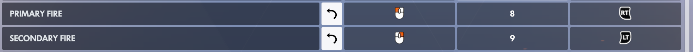
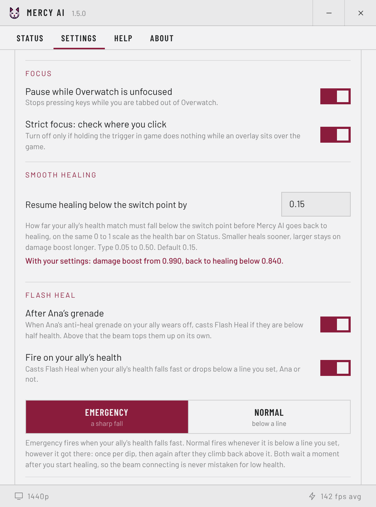
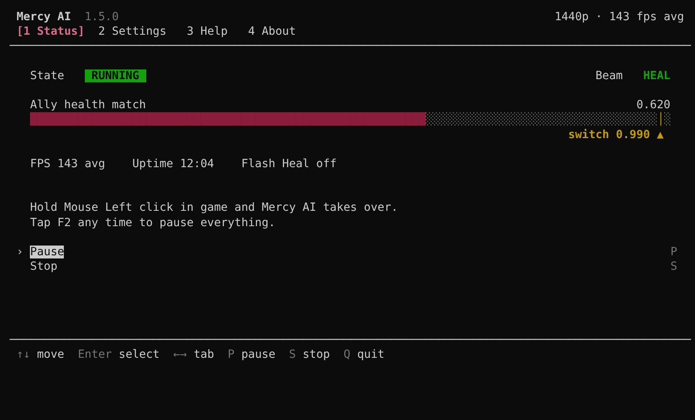

<p align="center"></p>

# Mercy AI

Pocket healing for Mercy in Overwatch. Hold your trigger on an ally and Mercy AI
heals them while they are hurt, then switches to damage boost once they are full.
You keep aiming and moving; it only picks the beam.

**[Download the latest version](https://github.com/Hexer-7/Overwatch-Mercy-AI/releases)** ·
[Watch a short video](https://www.youtube.com/watch?v=EXC9dg-d7_c)

## How to use it

**1. Set up Overwatch once**

- Health bars: *Options > Video > Colour Blind*, set health, shield, armour and
  overhealth to **white**.
- Display: *Options > Video > Display mode*, choose **Fullscreen** (not
  borderless) on your main monitor.
- Keys: *Options > Controls > Mercy*, add a keyboard key as a second binding for
  **Primary Fire** (heal) and another for **Secondary Fire** (damage boost). Keep
  your mouse bindings.




**2. Open Mercy AI**

Answer **Yes** when Windows asks for administrator rights, then follow the
three setup steps: confirm the game settings, press the same two keys you bound
in Overwatch, and pick your screen resolution.

**3. Play**

Hold **left click** on an ally. Mercy AI heals until they are full, then boosts
their damage. Let go and it stops. Press **F2** at any time to pause it.

## Good to know

- **When to boost.** The dial in Settings decides how full your ally must be
  before damage boost starts. 10 waits for full health; lower numbers boost
  earlier.
- **Ana's grenade.** While your ally has anti-heal on them, Mercy AI switches to
  damage boost, since healing does nothing.
- **Flash Heal** (off until you turn it on). Casts Flash Heal when Ana's grenade
  wears off, or when your ally's health drops low.
- **Smooth healing** (off until you turn it on). Stays on damage boost through
  small hits instead of flicking back to heal.
- **Advanced settings.** Change the trigger, pause key and Flash Heal behaviour
  under Settings > Advanced. Try changes in the Practice Range first.



## If nothing happens

- Make sure you answered **Yes** to the administrator prompt.
- Check that health bars are white and the game is fullscreen on your main
  monitor.
- Check that the keys in Mercy AI are the same ones you bound in Overwatch.
- Check the resolution under Settings > Advanced matches your screen.
- If an overlay sits over the game, turn off *Strict focus* under Settings >
  Advanced > Focus.

## Fine tuning in config.xml

A few settings exist only in `config.xml`, next to `Mercy AI.exe`. Most players
never need them. Edit the file in a text editor; changes apply the next time you
change a setting in Mercy AI or restart it.

<details>
<summary>Show the settings</summary>

| Setting | Default | Range | What it does |
|---|---|---|---|
| `ana_bomb_threshold` | 0.74 | 0 to 1 | How sure the match must be before Ana's grenade counts. |
| `action_cooldown` | 0.2 | 0 to 5 | Shortest time in seconds between two beam switches. |
| `target_fps` | 0 | 0 to 1000 | Limit on screen checks per second. 0 means no limit. |
| `switch_hysteresis` | 0 | 0 to 0.5 | Dead band around the switch point, to stop the beam flickering. |
| `fast_capture` | 1 | 0 or 1 | Faster screen capture. Set 0 only if the capture looks wrong. |
| `flash_heal_cooldown` | 0 | 0 to 120 | Extra seconds to wait between two Flash Heal presses. |
| `flash_heal_min_heal_time` | 0.5 | 0 to 10 | Seconds the beam must already be healing before Flash Heal may fire. |
| `flash_heal_settle` | 0.4 | 0 to 5 | Seconds ignored after you press the trigger, while the beam connects. |
| `flash_heal_max_fall_rate` | 60 | 0 to 500 | Falls faster than this are ignored as a covered screen. 0 turns it off. |
| `flash_heal_blank_floor` | 0.02 | 0 to 0.5 | Health readings at or below this are ignored. 0 turns it off. |

</details>

## Text version

Mercy AI also runs in a console, with the same settings, driven by the arrow
keys and Enter. Open a command prompt in its folder and run `"Mercy AI.exe" -cli`.
`"Mercy AI.exe" -help` lists every option.



## Fair play

Mercy AI reads the screen and presses keys for you. Automated input may conflict
with the Overwatch terms of service; whether to use it is your decision.

---

## For developers

The source is in `mercy_ai/`: the control loop (`loop.py`, `flash_heal.py`),
screen matching (`vision.py`, `imageops.py`), the window (`ui/`) and the text
version (`cli/`). Run it from source on Windows with Python 3.10 or newer:

```
pip install -r requirements-build.txt
python -m mercy_ai
```

Tests run on any platform with `python -m pytest`. `build.bat` builds the single
`Mercy AI.exe`, and GitHub Actions builds it on every push.

Apache License 2.0. Instagram: [_1_B](https://www.instagram.com/_1_B/) ·
GitHub: [Hexer-7](https://github.com/Hexer-7)
